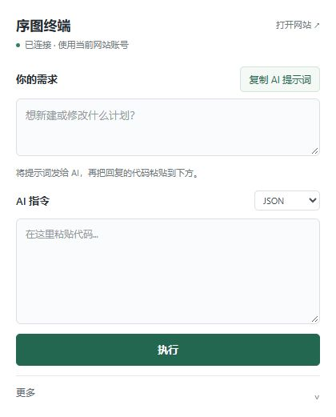

# 序图终端 2.2.1

本次精简界面：移除装饰图标、步骤编号、卡片副标题和页脚；保留两个输入框、复制提示词和执行按钮。CLI、兼容性与帮助统一收进“更多”。修复弹窗被挤窄、标题逐字换行的宽度规则。

## 第一次安装：先下载这个

**只想让 AI 帮你改计划：下载 [xutu-control-terminal-v2.2.1-chrome.zip](https://github.com/mkiekuum/xutu-control-terminal/releases/download/v2.2.1/xutu-control-terminal-v2.2.1-chrome.zip)。** Chrome / Edge 都使用这份插件包；普通复制粘贴用法不需要 Node.js、CLI 或 API Key。当前优先支持 Windows，Chrome 最低版本 135；其他浏览器组合未全部实测。

| 文件 | 用途 |
| --- | --- |
| `xutu-control-terminal-v2.2.1-chrome.zip` | 日常使用：浏览器插件，推荐新手 |
| `xutu-control-terminal-v2.2.1-windows.zip` | 可选：插件、Windows CLI、宿主安装器与手册 |
| `xutu-control-terminal-v2.2.1-source.zip` | 开发维护：完整源码、测试和发布配置 |
| `SHA256SUMS` | 下载文件的校验值 |

GitHub 自动生成的 `Source code (zip)` / `Source code (tar.gz)` 是仓库源码，不是给新手直接安装的插件包。

## 安装插件（约两分钟）

1. 下载上面的 **chrome.zip**，右键“全部解压”，保存到一个以后不会删除或移动的文件夹，例如“文档 → 序图终端”。不要直接在压缩包里操作。
2. 打开浏览器，在地址栏输入 `chrome://extensions`；Edge 输入 `edge://extensions`，按回车。
3. 开启页面上的“开发者模式”，点击“加载已解压的扩展程序”或“加载解压缩的扩展”。
4. 选择**直接包含 `manifest.json` 的文件夹**。插件 ZIP 解压后的根目录就有它；Windows 整包则选择里面的 `extension` 文件夹。
5. 点击浏览器右上角的拼图图标，找到“序图终端”，固定到工具栏。打开[序图网站](https://plan.fpgabbs.cn/)，使用你自己的账号登录。
6. 点击“序图终端”图标。出现“你的需求”和“AI 指令”两个输入框，且显示“已连接”，就可以开始使用。

浏览器加载与重新加载操作可对照 [Chrome 官方说明](https://developer.chrome.com/docs/extensions/get-started/tutorial/hello-world#load-unpacked) / [Edge 官方说明](https://learn.microsoft.com/en-us/microsoft-edge/extensions/getting-started/extension-sideloading)。

## 第一次使用

1. 在网站选中要修改的计划，在“你的需求”写清楚想怎么改；新建时写明“新建计划”。
2. 点击“复制 AI 提示词”，粘贴到你常用的 AI 聊天中。提示词包含当前计划详情；请自行选择要发给哪个 AI。
3. 如果 AI 提问，先回答；然后复制它在聊天里给出的**完整 JSON 代码块**。
4. 回到插件，粘贴到“AI 指令”，保持 JSON 格式，点击“执行”。查看返回结果，失败原因可复制给 AI 继续修正。

业务操作始终使用当前网站账号的实际权限。兼容性会自动做基础只读检查；需要排查时展开“更多 → 兼容性与排查 → 复制兼容状态”。

## 已装过旧版：怎么更新

1. 下载新版插件 ZIP，把原来的插件目录备份后，将新包内容解压覆盖到**原来加载的目录**；确认该目录里的 `manifest.json` 版本是 `2.2.1`。若原来加载的是 Windows 整包下的 `extension`，只覆盖那个子目录。
2. 在扩展管理页找到“序图终端”，点击一次“重新加载”（圆形箭头），再刷新序图网站。
3. 重新打开插件即可。使用 CLI 的用户再展开“更多”，点击“连接 CLI”。

保留原加载目录和扩展，不需要先卸载。GitHub 发布不会自动替换你电脑上开发者模式加载的文件；网站账号和计划保存在原网站，本次 UI 更新不修改计划。

## 可选：让本机 AI 通过 CLI 操作

只在你的 AI 能执行本机命令时需要，普通 AI 聊天可跳过。

1. 安装 [Node.js](https://nodejs.org/) 22 或更高版本。
2. 下载 **windows.zip**，解压到固定目录；在扩展管理页加载其中的 `extension` 文件夹（已有插件也可使用现有扩展 ID，不要同时启用两份）。
3. 在扩展管理页的“详细信息”复制该扩展的 32 位 ID；也可在插件“更多 → 本地 CLI”复制。
4. 双击整包内的 `native-host/INSTALL-WINDOWS.cmd`，粘贴 ID，按回车。安装只注册当前 Windows 用户的宿主；保留解压目录，移动后需重装。
5. 打开插件“更多 → 本地 CLI”，点击“连接 CLI”，再“复制 CLI 用法”交给本机 AI。
6. 如果你确实需要 JavaScript 指令，再在扩展详情开启“允许用户脚本”（浏览器提供该开关时）；普通 JSON 使用无需这一步。

详见 [Windows 手册](https://github.com/mkiekuum/xutu-control-terminal/blob/v2.2.1/docs/WINDOWS_INSTALL.md)、[换电脑与分享](https://github.com/mkiekuum/xutu-control-terminal/blob/v2.2.1/docs/CROSS_DEVICE.md)、[维护升级](https://github.com/mkiekuum/xutu-control-terminal/blob/v2.2.1/docs/GITHUB_MAINTENANCE.md)。

## 遇到问题

- **找不到 manifest.json**：选错了层级；进入解压目录，找到文件后再选择它所在的文件夹。
- **提示先登录 / 暂未连接**：在同一个浏览器登录序图，刷新网站，关闭再打开插件。
- **界面还是旧的**：检查覆盖目录是否正确，并在扩展管理页重新加载。
- **CLI 未连接**：普通复制粘贴不受影响；需要 CLI 时检查 Node.js、扩展 ID 和整包路径。
- **仍然失败**：复制“更多 → 兼容性与排查”里的状态；有扩展报错时，把错误文字一并交给维护者。

## 验证范围

71 项本地测试通过。420 × 600 的本地浏览器预览中，默认界面高度约 521 像素，无横向溢出，执行按钮完整可见；更多菜单与表单交互通过检查。本轮未操作真实鼠标，未修改任何网站计划。已安装 Chrome 弹窗的最终外观仍需重新加载后查看；不将本地预览冒充所有设备实测。
