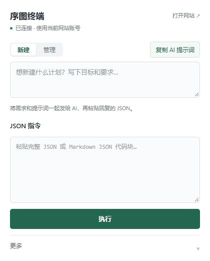

# 序图终端 2.3.0

保留需求输入框，一键复制时连同需求、完整计划上下文和网站规则一起复制。“新建 / 管理”默认新建；管理涵盖增删任务、结构、人员、进度等操作。

指令区仅接收原始 JSON 或 Markdown JSON 代码块，删除 CLI / JavaScript 格式切换。显式 JSON script.execute、浏览器用户脚本权限及后台执行逻辑保留。本机 xutu 命令、JSONL 批量、context、preview/validate、doctor 保持兼容。

“更多 → 本地 CLI”只保留“测试本地 CLI”“复制诊断结果”和安装/排查链接。每次测试分别验证宿主新响应，以及实际 CLI 子进程经认证管道查询主界面选中的网页；只有两步通过才显示整体成功，不改真实计划。

打开自动查新版：访问 GitHub /releases/latest，要求 HTTP 200 且最终地址为本仓库有效版本发布页。404 即使有页面也不算发布；不再调用版本 API 或读取版本文件。成功结果缓存 2 分钟、失败 30 秒，显示真实检查时间。可复制完整 AI Agent 更新指令。

## 第一次安装：先下载这个

**只想让 AI 帮你改计划：下载 [xutu-control-terminal-v2.3.0-chrome.zip](https://github.com/mkiekuum/xutu-control-terminal/releases/download/v2.3.0/xutu-control-terminal-v2.3.0-chrome.zip)。** Chrome / Edge 都使用这份插件包；普通复制粘贴用法不需要 Node.js、CLI 或 API Key。当前优先支持 Windows，Chrome 最低版本 135；其他浏览器组合未全部实测。

| 文件 | 用途 |
| --- | --- |
| `xutu-control-terminal-v2.3.0-chrome.zip` | 日常使用：浏览器插件，推荐新手 |
| `xutu-control-terminal-v2.3.0-windows.zip` | 可选：插件、Windows CLI、宿主安装器与手册 |
| `xutu-control-terminal-v2.3.0-source.zip` | 开发维护：完整源码、测试和发布配置 |
| `SHA256SUMS` | 下载文件的校验值 |

GitHub 自动生成的 `Source code (zip)` / `Source code (tar.gz)` 是仓库源码，不是给新手直接安装的插件包。

## 安装插件（约两分钟）

1. 下载上面的 **chrome.zip**，右键“全部解压”，保存到一个以后不会删除或移动的文件夹，例如“文档 → 序图终端”。不要直接在压缩包里操作。
2. 打开浏览器，在地址栏输入 `chrome://extensions`；Edge 输入 `edge://extensions`，按回车。
3. 开启页面上的“开发者模式”，点击“加载已解压的扩展程序”或“加载解压缩的扩展”。
4. 选择**直接包含 `manifest.json` 的文件夹**。插件 ZIP 解压后的根目录就有它；Windows 整包则选择里面的 `extension` 文件夹。
5. 点击浏览器右上角的拼图图标，找到“序图终端”，固定到工具栏。打开[序图网站](https://plan.fpgabbs.cn/)，使用你自己的账号登录。
6. 点击“序图终端”图标。出现“新建 / 管理”、需求输入框和 JSON 指令框，且显示“已连接”，就可以开始使用。

浏览器加载与重新加载操作可对照 [Chrome 官方说明](https://developer.chrome.com/docs/extensions/get-started/tutorial/hello-world#load-unpacked) / [Edge 官方说明](https://learn.microsoft.com/en-us/microsoft-edge/extensions/getting-started/extension-sideloading)。

## 第一次使用

1. 默认选择“新建”，写下新计划的目标；要处理已有计划，先选“管理”，并在网站选中目标计划。
2. 在需求框填写具体要求，点击“复制 AI 提示词”，将需求与资料一起粘贴到你常用的 AI 聊天中。提示词包含当前计划详情；请自行选择要发给哪个 AI。
3. 如果 AI 提问，先回答；然后复制它在聊天里给出的**完整 JSON 代码块**。
4. 回到插件，粘贴到“JSON 指令”，点击“执行”。查看返回结果，失败原因可复制给 AI 继续修正。

业务操作始终使用当前网站账号的实际权限。兼容性会自动做基础只读检查；需要排查时展开“更多 → 兼容性与排查 → 复制兼容状态”。

## 软件版本与 AI Agent 更新

打开插件即自动检查官方 GitHub 的最新正式版，显示当前版本和检查时间；打开会自动触发检查，无需额外按钮；短时重复打开复用带时间的缓存。有新版时底部显示“更多 · 有新版本”。访问受限、超时或无有效发布页会显示无法确认，不会冒称已是最新版。

展开“更多 → 软件更新”，点击“复制 AI 更新指令”，交给能操作本机的 AI Agent。指令带当前版本、检查结果、扩展 ID、官方仓库、自动定位/下载/校验/备份/安装/回读/失败回滚步骤；要求不发维护问卷、不操作真实鼠标、不修改网站计划，换电脑要重新发现实际路径和 ID。复制本身不会更新软件，也不会向 AI 自动发送内容。

本版为公共版本检查增加 GitHub 官网读取权限，不申请 API 或附件 CDN 主机权限；请求不携带网站账号、计划内容或 Cookie。浏览器若要求确认新增权限，请按浏览器提示操作。真实登录、强制人工授权等步骤不能由提示词绕过。详细说明见 [自动版本检测与 Agent 更新](https://github.com/mkiekuum/xutu-control-terminal/blob/v2.3.0/docs/AUTO_UPDATE.md)。

## 已装过旧版：怎么更新

1. 下载新版插件 ZIP，把原来的插件目录备份后，将新包内容解压覆盖到**原来加载的目录**；确认该目录里的 `manifest.json` 版本是 `2.3.0`。若原来加载的是 Windows 整包下的 `extension`，只覆盖那个子目录。
2. 在扩展管理页找到“序图终端”，点击一次“重新加载”（圆形箭头），再刷新序图网站。
3. 重新打开插件即可。使用 CLI 的用户选中目标网页后，在“更多 → 本地 CLI”点击“测试本地 CLI”。

保留原加载目录和扩展，不需要先卸载。GitHub 发布不会自动替换你电脑上开发者模式加载的文件；网站账号和计划保存在原网站，本次 UI 更新不修改计划。

## 可选：让本机 AI 通过 CLI 操作

只在你的 AI 能执行本机命令时需要，普通 AI 聊天可跳过。

1. 安装 [Node.js](https://nodejs.org/) 22 或更高版本。
2. 下载 **windows.zip**，解压到固定目录；在扩展管理页加载其中的 `extension` 文件夹（已有插件也可使用现有扩展 ID，不要同时启用两份）。
3. 在扩展管理页的“详细信息”复制该扩展的 32 位 ID。
4. 双击整包内的 `native-host/INSTALL-WINDOWS.cmd`，粘贴 ID，按回车。安装只注册当前 Windows 用户的宿主；保留解压目录，移动后需重装。
5. 在主界面选中序图网页，展开“更多 → 本地 CLI”点击“测试本地 CLI”，分别查看宿主与网页两段结果。本机命令示例继续保留在安装手册中。
6. 如果你的 JSON 显式使用 script.execute，再在扩展详情开启“允许用户脚本”（浏览器提供该开关时）；其他普通业务 JSON 无需这一步。

详见 [Windows 手册](https://github.com/mkiekuum/xutu-control-terminal/blob/v2.3.0/docs/WINDOWS_INSTALL.md)、[换电脑与分享](https://github.com/mkiekuum/xutu-control-terminal/blob/v2.3.0/docs/CROSS_DEVICE.md)、[维护升级](https://github.com/mkiekuum/xutu-control-terminal/blob/v2.3.0/docs/GITHUB_MAINTENANCE.md)。

## 遇到问题

- **找不到 manifest.json**：选错了层级；进入解压目录，找到文件后再选择它所在的文件夹。
- **提示先登录 / 暂未连接**：在同一个浏览器登录序图，刷新网站，关闭再打开插件。
- **界面还是旧的**：检查覆盖目录是否正确，并在扩展管理页重新加载。
- **CLI 未连接**：普通复制粘贴不受影响；需要 CLI 时检查 Node.js、扩展 ID 和整包路径。
- **仍然失败**：复制“更多 → 兼容性与排查”里的状态；有扩展报错时，把错误文字一并交给维护者。

## 验证范围

91 项本地测试通过，0 失败、0 跳过。覆盖 JSON/代码块解析、CLI/独立 JavaScript 拒绝、显式 JSON 脚本权限与执行、本机 CLI 子进程/认证管道、context/JSONL/preview/validate 兼容、宿主未连接/网页失败/未选目标/测试成功、无额外标签扫描、诊断脱敏及发布网页状态、404 判定、HEAD 回退 GET 与缓存。业务写入回归仅用本地契约模拟。

浏览器本地只读预览验证需求框、JSON 框及 CLI 面板；未点击浏览器界面、未操作真实鼠标、未修改网站计划。新版在当前登录浏览器的安装重载、两段 CLI 与用户脚本授权需由用户实际操作后核验；没有把模拟网页冒充真实站点。AI Agent 升级/回滚也未宣称已实际执行。

[CLI 测试与故障排查](https://github.com/mkiekuum/xutu-control-terminal/blob/v2.3.0/docs/CLI_DIAGNOSTICS.md) · [完整测试报告](https://github.com/mkiekuum/xutu-control-terminal/blob/v2.3.0/docs/TEST_REPORT.md)
